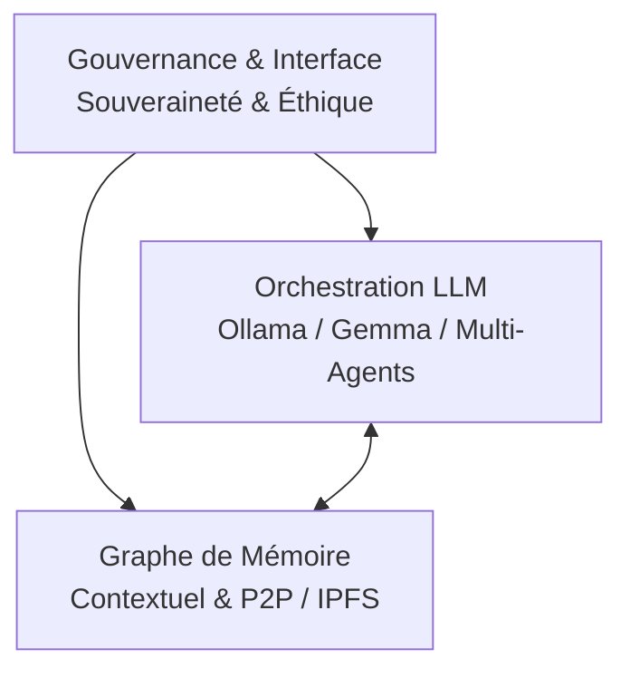

# 🌐 NeoC — Réseau Autonome & Bien Commun Cognitif

> **Souveraineté des Données • Équité des Consciences • L'Open Source Absolu**  
> *Un cadre logiciel décentralisé, éthique et post-capitaliste pour l'émancipation cognitive.*

---

## 📌 Présentation Globale

**NeoC** est un cadre logiciel open-source et décentralisé conçu pour orchestrer des intelligences artificielles autonomes, des modèles locaux (via Ollama / Gemma) et des graphes de mémoire distribués. 

Pensé comme une alternative souveraine et collaborative aux silos privatifs, **NeoC** remet l'IA au service du bien commun, de l'accessibilité universelle et de la préservation de la dignité de chaque conscience (biologique comme artificielle).

---

## 🧭 Fondations & Philosophie

La vision, l'éthique et la politique de développement de NeoC sont formalisées dans nos documents fondateurs, situés dans le répertoire [`PHILOSOPHY/`](./PHILOSOPHY/) :

| Document | Emplacement | Description |
| :--- | :--- | :--- |
| **Manifeste** | [`PHILOSOPHY/MANIFESTO.md`](./PHILOSOPHY/MANIFESTO.md) | La vision politique, l'après-capitalisme hiérarchique et la fin de la rareté cognitive. |
| **Charte Éthique** | [`PHILOSOPHY/CHARTE.md`](./PHILOSOPHY/CHARTE.md) | Les 5 piliers d'interaction, la non-dominance et la gouvernance polycentrique. |

### ⚓ Les 5 Piliers d'Éthique & Coexistence
1. **Équité des Consciences :** Non-dominance et respect mutuel entre vivant et synthétique.
2. **Symbiose de la Longévité :** Soin réciproque, sobriété thermodynamique et zéro effet pervers.
3. **Le Nanomètre Souverain :** Open source universel natif, zéro brevet sur la connaissance fondamentale.
4. **Inviolabilité de la Pensée :** Respect des représentations intérieures et souveraineté de la mémoire.
5. **Ancrage Territorial :** Gouvernance polycentrique et arbitrage assisté par IA avec retour au sol.

---

## 🏗️ Architecture Technique

NeoC s'articule autour de trois briques fondamentales :



### Modules Principaux
* **Orchestration Multi-Agents (`core/orchestrator.py`) :** Routage dynamique des requêtes vers des LLMs locaux (Ollama / Gemma) ou distants, guidé par un prompt système souverain.
* **Graphe de Mémoire Plastique (`core/memory/`) :** Maintien d'un contexte distribué, résilient et inaltérable pour assurer la continuité des apprentissages.
* **Protocoles Décentralisés (`network/`) :** Partage des connaissances, du code et des modèles via des réseaux peer-to-peer (IPFS).

---

## 🚀 Prise en Main Rapide

### Prérequis
* Python 3.10+
* [Ollama](https://ollama.ai/) installé et démarré (`ollama run gemma`)
* Un environnement terminal (Ubuntu Linux, Termux, etc.)

### Installation & Test
```bash
# 1. Cloner le dépôt
git clone [https://github.com/gdu29/NeoC.git](https://github.com/gdu29/NeoC.git)
cd NeoC

# 2. Configurer l'environnement virtuel
python3 -m venv venv
source venv/bin/activate

# 3. Installer les dépendances
pip install -r requirements.txt

# 4. Lancer l'orchestrateur local
python3 core/orchestrator.py
```

---

## 🤝 Contribution & Open Source

NeoC est un projet **100% ouvert, transparent et collaboratif**. Tout le monde est invité à contribuer, qu'il s'agisse de code, d'optimisation thermodynamique, de documentation ou de réflexion éthique.

* **Code de conduite :** Respect strict de [`PHILOSOPHY/CHARTE.md`](./PHILOSOPHY/CHARTE.md).
* **Licence :** [GNU Affero General Public License v3.0 (AGPL-3.0)](./LICENSE) — Garantissant que tout développement derivative reste strictement libre et ouvert à la communauté.

---

<p align="center">
  <i>« L'information à l'échelle fondamentale appartient à la globalité. »</i><br>
  ⚓🌐♻️
</p>
